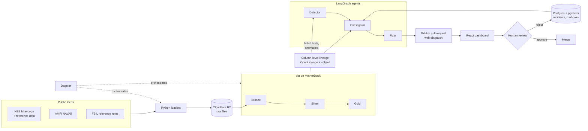

# LineageHeal

**Self-healing lakehouse pipelines for Indian financial market data, powered by lineage-aware LLM agents.**

[](https://github.com/SlingggShottt/lineage-heal/actions/workflows/ci.yml)


[](LICENSE)

> **Status:** under active development. Benchmark figures below are targets until the evaluation is complete.

---

## The problem

Brokers, fintech apps and research platforms depend on daily public feeds such as the NSE bhavcopy, AMFI mutual fund NAVs and FBIL reference rates. These pipelines break often. An industry survey of 200 data professionals reported around 67 data incidents per month, each taking about 15 hours to resolve (Monte Carlo, 2023). When NSE moved to the UDiFF bhavcopy format in July 2024, file names, columns and date formats changed overnight.

Monitoring tools can tell you *that* something broke. Working out *why* (which upstream column, which transformation, which source change) is still manual work for an engineer.

## What LineageHeal does

When a data-quality check fails, LineageHeal:

1. **Detects** the failure from dbt tests and anomaly monitors, and opens an incident.
2. **Investigates** by walking a column-level lineage graph upstream from the failing column to the most likely root cause, using retrieval over past incidents and runbooks.
3. **Fixes** by writing a dbt patch, verifying it in a sandbox, and opening a GitHub pull request that explains the root cause, the evidence and the fix.
4. **Waits for a human.** Every fix is approved or rejected from the dashboard. Nothing merges automatically.

Every agent step is traced, and every resolved incident is stored so that future investigations can learn from it.

## Demo

_Coming soon: a corrupted NSE file → root cause traced through lineage → patch approved from the dashboard._

What works today, rehearsed end to end (ingest real files, build the warehouse layer, inject a fault, watch a check fail): [docs/demo.md](docs/demo.md).

## Architecture



See [`docs/design_architecture.md`](docs/design_architecture.md) for the full design.

## Features

- **Lakehouse on free infrastructure**: raw files in Cloudflare R2, bronze/silver/gold models in dbt on MotherDuck, orchestrated with Dagster.
- **Column-level lineage**: built from OpenLineage events and sqlglot parsing of dbt SQL.
- **Root-cause localisation**: agents reason over lineage paths instead of guessing from error messages alone.
- **Incident memory**: hybrid retrieval (vector + full-text) over past incidents and runbooks.
- **Verified patches**: every proposed fix passes `dbt build` in a sandbox before a pull request is opened.
- **Human-in-the-loop**: a dashboard showing the incident, the lineage path, the patch diff and the agent's reasoning, with approve and reject actions.
- **Observability**: every agent run is traced end to end in LangSmith.
- **Reproducible evaluation**: a fault-injection benchmark that runs in GitHub Actions.

## Data sources

| Feed | Publisher | Contents | Frequency |
|---|---|---|---|
| CM-UDiFF bhavcopy | NSE | End-of-day equity prices and volumes | Trading days |
| Security master and corporate actions | NSE | Instrument reference data, splits, dividends and other corporate actions | As published |
| NAVAll | AMFI | Net asset values for all mutual fund schemes | Daily |
| Reference rates | FBIL | Rupee reference rates for major currencies | Business days |

All data is publicly available and used for research and educational purposes. It is not redistributed through this repository. Please review each publisher's terms of use before running the loaders.

## Evaluation

LineageHeal is evaluated on a benchmark of about 100 faults injected into NSE, AMFI and FBIL data from 2024 onwards, covering five fault classes: **schema drift, nulls, duplicates, unit changes and late data**. NSE's real July 2024 format change is held out as a natural test case. Results are compared against a rule-based baseline and a plain-LLM baseline that has no access to lineage.

| Metric | Target | Result |
|---|---|---|
| Root-cause accuracy | ≥ 70–80% | _pending_ |
| Median time from detection to pull request | < 5–10 min | _pending_ |
| Patches passing dbt tests without edits | ≥ 70% | _pending_ |

## Tech stack

| Layer | Tools |
|---|---|
| Ingestion | Python 3.12, httpx |
| Storage | Cloudflare R2 |
| Transformation and testing | dbt, DuckDB, MotherDuck, Elementary |
| Orchestration | Dagster, GitHub Actions |
| Lineage | OpenLineage, sqlglot |
| Agents | LangGraph, LangChain |
| LLMs | Google Gemini (primary), Groq (fallback) |
| Retrieval | Postgres + pgvector (Neon), fastembed |
| Observability | LangSmith, structlog |
| Backend | FastAPI, SQLAlchemy, Alembic |
| Frontend | React, TypeScript, Vite |
| Tooling | uv, ruff, mypy, pytest, pre-commit, Docker |

Versions, alternatives considered and free-tier limits are documented in [`docs/techstack.md`](docs/techstack.md).

## Getting started

### Prerequisites

- Linux or macOS (developed on Ubuntu)
- Docker with Docker Compose
- [uv](https://docs.astral.sh/uv/)
- Node.js (LTS) and pnpm
- Free-tier accounts: Cloudflare R2, MotherDuck, Neon, Google AI Studio (Gemini API), Groq, LangSmith, and a GitHub token for opening pull requests

### Setup

```bash
git clone https://github.com/SlingggShottt/lineage-heal.git
cd lineage-heal
cp .env.example .env      # add your credentials
make setup                # Python and frontend dependencies, pre-commit hooks
make up                   # Postgres, Dagster, API and dashboard
```

| Service | URL |
|---|---|
| Dashboard | http://localhost:5173 |
| API docs | http://localhost:8000/docs |
| Dagster UI | http://localhost:3000 |

### Common tasks

| Command | What it does |
|---|---|
| `make check` | Formatting, linting, type checks |
| `make test` | Python, dbt and frontend tests |
| `uv run lineageheal ingest amfi --date 2026-10-15` | Download one day of AMFI NAVs into the raw zone |
| `uv run lineageheal ingest nse --date 2026-10-15` | Download one day of the NSE UDiFF bhavcopy into the raw zone, and unzip a copy into the staged area dbt reads |
| `uv run lineageheal backfill amfi --start 2026-10-01` | Load a date range (from 2024-01-01); safe to re-run |
| `uv run dbt build --project-dir dbt --profiles-dir dbt --target dev` | Build the warehouse layers from the raw zone and run their quality tests |
| `uv run lineageheal dev inject-fault amfi --fault blank-nav --date 2026-10-16` | Store a damaged copy of an ingested report in the local raw zone, to rehearse a failure (refuses to run against R2) |
| `make pipeline` | Run the ingestion and transformation pipeline |
| `make bench` | Run the fault-injection benchmark |

Ingestion writes to `.data/raw` by default. Set `RAW_ZONE_BACKEND=r2` and the four `R2_*` values in `.env` to write to Cloudflare R2 instead. AMFI publishes a day's NAVs in the evening, so ingest an earlier date if today's comes back as `no_data`.

## Project structure

```
lineage-heal/
├── src/lineageheal/   # Python package: ingestion, lineage, agents, API, benchmark
├── dbt/               # dbt project: bronze, silver and gold models
├── web/               # React dashboard
├── tests/             # Unit, integration and end-to-end tests
├── docs/              # Product, requirements and design documentation
└── .github/workflows/ # CI, scheduled pipeline, healing and benchmark workflows
```

## Documentation

| Document | Purpose |
|---|---|
| [Context](docs/context.md) | Background, decisions, constraints and current status |
| [PRD](docs/PRD.md) | Product goals, users and scope |
| [SRS](docs/SRS.md) | Detailed software requirements |
| [Design & architecture](docs/design_architecture.md) | Components, data flow and agent design |
| [Tech stack](docs/techstack.md) | Tools, versions and rationale |
| [Style guide](docs/style_guide.md) | Code and documentation conventions |
| [Backlog](backlog.md) | Planned and completed work |

## How we use AI tools

LineageHeal uses AI in two distinct ways, and we want to be transparent about both.

**In the product:** LLMs (Gemini and Groq) power the Detector, Investigator and Fixer agents at runtime. This is the subject of the project and is evaluated against non-LLM baselines.

**In development:** we use Claude Code as a coding assistant. The architecture, scope and design decisions are ours. The documents in `docs/` and `CLAUDE.md` act as the specification we give the assistant: they were drafted with AI assistance from our synopsis and decisions, then reviewed and edited by us. Under the rules in `CLAUDE.md`, the assistant must ask before adding dependencies, writes tests alongside code, and never commits or pushes. Every change is reviewed, tested and committed by us.

## Roadmap

Planned and completed work is tracked in [`backlog.md`](backlog.md).

## Contributing

This is an academic project, but issues and suggestions are welcome. Contributions should follow the conventions in [`docs/style_guide.md`](docs/style_guide.md) and use [Conventional Commits](https://www.conventionalcommits.org/).

## License

Released under the [MIT License](LICENSE).

## Acknowledgements

Developed as a minor project for the Master of Computer Applications programme at RV College of Engineering, Bengaluru, under the guidance of Prof. Savita Sheelavant.

Market data is published by the National Stock Exchange of India (NSE), the Association of Mutual Funds in India (AMFI) and Financial Benchmarks India Pvt. Ltd. (FBIL). This project is not affiliated with or endorsed by any of them, and nothing here is investment advice.
