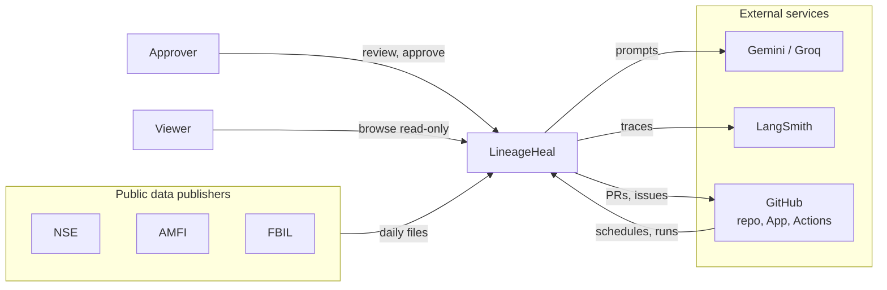
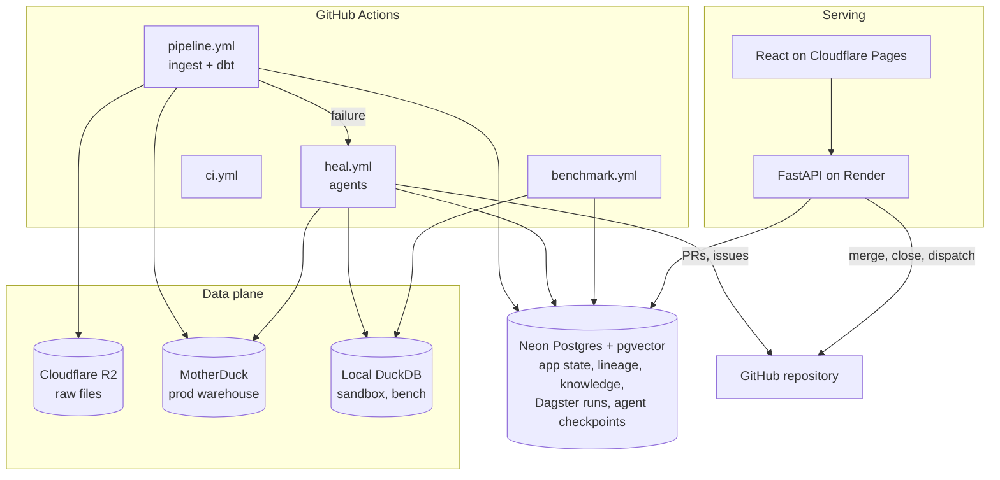
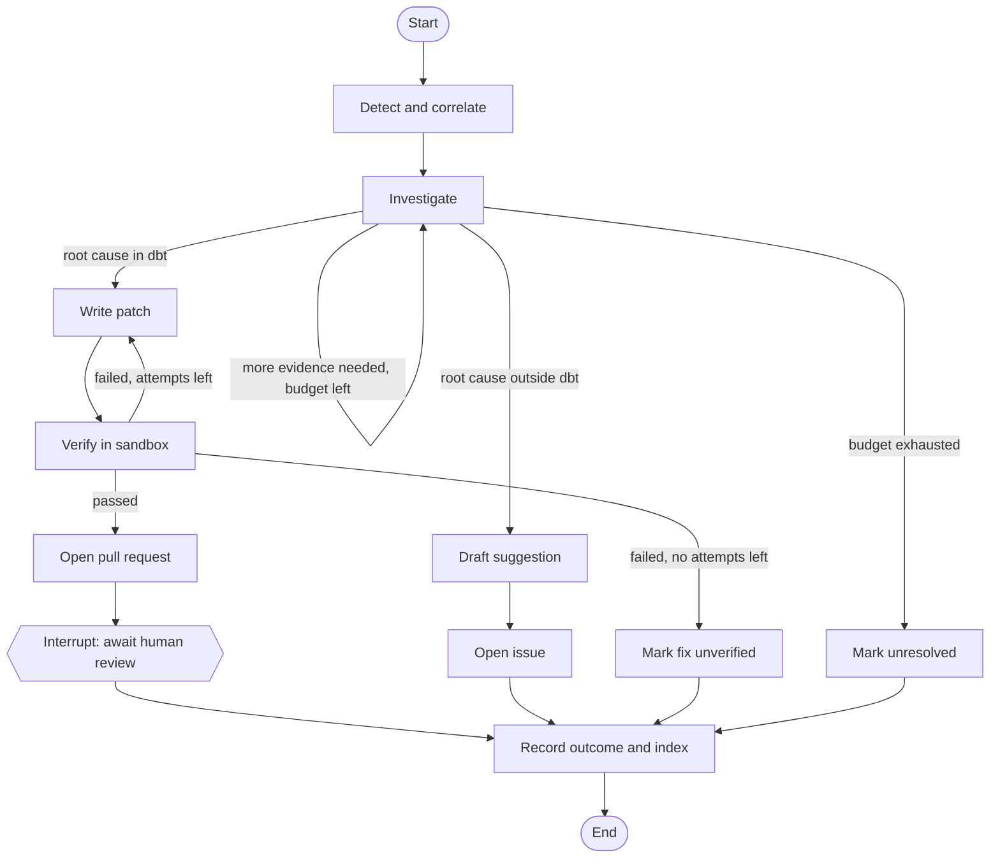
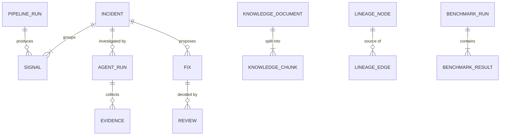
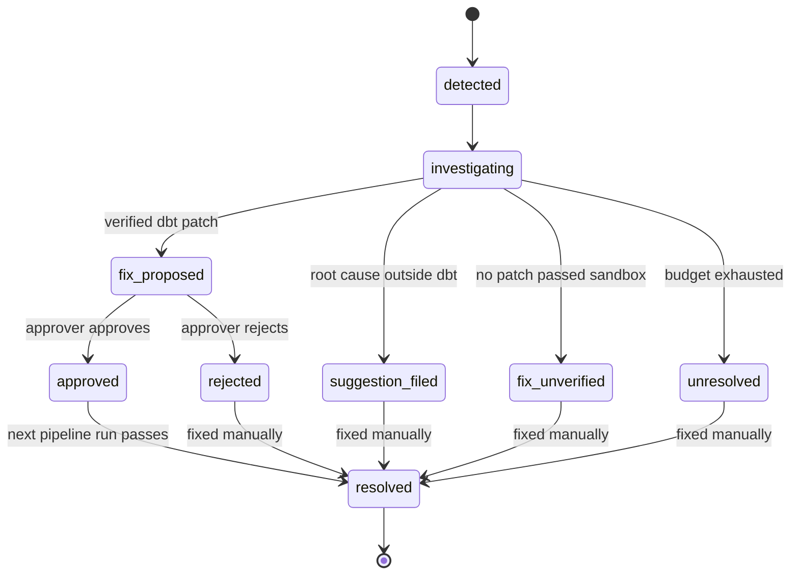
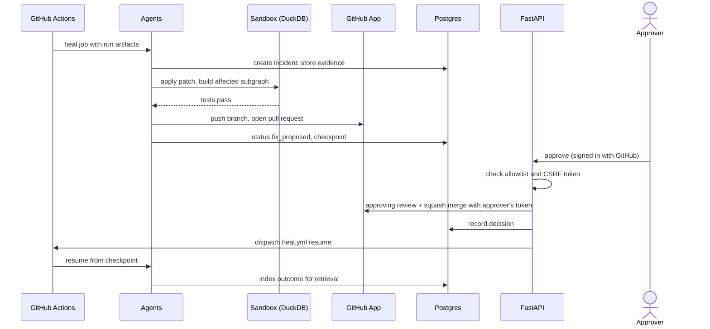

# Design and Architecture — LineageHeal

| | |
|---|---|
| **Status** | Baseline for build |
| **Last updated** | Week 2 |
| **Related** | [SRS](SRS.md) · [Tech stack](techstack.md) · [Style guide](style_guide.md) · [Context](context.md) |

## 1. Purpose

This document explains how LineageHeal is put together: its components, data flows, agent design, data models, deployment and the reasoning behind them. Requirements live in the SRS; this document describes how they are met. Significant decisions are summarised in [context.md](context.md#key-decisions) and recorded in detail as ADRs in `docs/adr/`.

## 2. System context



## 3. Runtime topology



Design choices worth noting:

- **Heavy work runs in GitHub Actions, not on the API host.** Render's free instance has 512 MB of memory and sleeps when idle, so the API only serves reads and records decisions. Healing, benchmark runs and post-decision indexing all execute as workflows.
- **Two warehouses, one dbt project.** `prod` targets MotherDuck. `dev`, `ci` and `bench` target local DuckDB files. The sandbox and the benchmark never touch MotherDuck, which protects its free compute allowance.

## 4. Repository structure

See the repository map in [CLAUDE.md](../CLAUDE.md#repository-map). Each Python subpackage under `src/lineageheal/` owns one concern and depends only on `core` and on packages below it in this order:

```
core  ←  store  ←  ingestion, lineage, llm, vcs, rag  ←  agents  ←  orchestration, api, benchmark
```

`api` and `orchestration` never import each other. A command-line entry point, `lineageheal` (built with Typer), exposes `ingest`, `backfill`, `detect`, `heal`, `index` and `bench` commands so that GitHub Actions and developers use the same code path.

## 5. Data architecture

### 5.1 Raw zone (R2)

```
raw/source=<source>/dataset=<dataset>/trade_date=<YYYY-MM-DD>/<sha256-prefix>__<original_filename>
```

- Files are stored exactly as published (compressed where the source compresses them).
- The SHA-256 prefix (first 16 hex characters; the full digest is stored as object metadata) makes a changed re-publication a new object instead of an overwrite (FR-ING-05). An identical file resolves to the existing key and is skipped. Reading a file re-checks its hash against the key.
- File names are reduced to `A-Za-z0-9._-` before they enter a key.
- `RAW_ZONE_BACKEND` selects `r2` (the bucket) or `local` (a directory, `.data/raw` by default). Tests, offline development and benchmark sandboxes use `local`, so they cannot touch the production bucket.
- Every attempt is recorded in the `ingestion_log` table (FR-ING-06).
- Benchmark and sandbox copies live outside the raw zone (`bench/` prefix or a local directory), so injected faults can never contaminate production data.

### 5.2 Source datasets

| Source | Dataset | Bronze model |
|---|---|---|
| NSE | `cm_bhavcopy` (CM-UDiFF) | `brz_nse__cm_bhavcopy` |
| NSE | `security_master` | `brz_nse__security_master` |
| NSE | `corporate_actions` | `brz_nse__corporate_actions` |
| AMFI | `navall` | `brz_amfi__navall` |
| FBIL | `reference_rates` | `brz_fbil__reference_rates` |

#### Source access details

Filled in by the Week 2 data spike (LH-012, LH-013).

| Dataset | URL pattern | Format | Headers needed | Publication time (IST) | History available | Reachable from Actions |
|---|---|---|---|---|---|---|
| NSE `cm_bhavcopy` | `https://nsearchives.nseindia.com/content/cm/BhavCopy_NSE_CM_0_0_0_YYYYMMDD_F_0000.csv.zip` | Zip holding one CSV: 34 columns, ISO dates, LF endings, two-decimal prices, about 3,700 rows | Browser-like User-Agent and `Accept` headers; see [NSE findings](#nse-findings) | About 16:30 IST on the trade date | UDiFF back to at least 2 Jan 2024; old format until 5 Jul 2024 | Not tested yet (check in LH-033) |
| NSE `security_master` | `https://nsearchives.nseindia.com/content/cm/NSE_CM_security_DDMMYYYY.csv.gz` | Gzipped CSV with 120 named columns, about 38,100 rows, regular (no ragged or quoted lines) | As above | About 20:20 IST | Not available for 2 Jan 2024 (404); earliest date unknown | Not tested yet |
| NSE `corporate_actions` | `https://www.nseindia.com/api/corporates-corporateActions?index=equities&from_date=DD-MM-YYYY&to_date=DD-MM-YYYY` | JSON array of objects | As above; answered without cookies in the spike | Not measured | Date ranges back to at least Jan 2024 | Not tested yet |
| AMFI `navall` | `https://portal.amfiindia.com/DownloadNAVHistoryReport_Po.aspx?frmdt=DD-Mon-YYYY&todt=DD-Mon-YYYY` (set both to the same date). Live snapshot: `https://portal.amfiindia.com/spages/NAVAll.txt` | Semicolon-delimited text, UTF-8, CRLF; see [AMFI findings](#amfi-findings) | None; the default curl User-Agent worked | Evening; not yet published at 18:47 IST on the same day, and the live file was last modified 15:27 IST on 19 Oct 2026 | From at least 2 Jan 2024 (tested), one request per date | Not tested yet (check in LH-033) |
| FBIL `reference_rates` | Not found. `fbil.org.in` is a JavaScript application with reCAPTCHA and exposes no plain file URL (LH-080) | Unknown | Unknown | Unknown | Unknown | Not tested |

#### NSE findings

Measured on 19 October 2026 (LH-012) with about 16 requests, spaced at least four seconds apart, from a home network (not yet from a GitHub Actions runner).

- **The project User-Agent is rejected.** NSE sits behind Akamai. A request identifying itself as `lineageheal/0.1` was reset (curl error 92, an HTTP/2 stream reset), with or without `Accept` headers. A Chrome-style User-Agent with `Accept` and `Accept-Language` headers was served over HTTP/2 and HTTP/1.1. NSE loaders therefore send a browser-like User-Agent (as the data rules in CLAUDE.md anticipate), keep the three-second spacing, and never retry in a tight loop.
- **The loader** (`ingestion/nse.py`) stores the zip exactly as published after checking it is an intact zip (a damaged, truncated or HTML response is rejected, never stored), and reports a 404 as `no_data`. A 404 is normal for weekends and holidays but is also what NSE returns before publication or when a file is genuinely missing, so telling those apart needs the exchange calendar (LH-016). Verified live: the stored zip for 16 Oct 2026 was byte-identical (same SHA-256) to a manual download.
- **The reference loaders** (`NseSecurityMasterLoader`, `NseCorporateActionsLoader`) share the bhavcopy loader's flow: the file is validated (a complete gzip, or a JSON list), stored as published, and a 404 is `no_data`. The corporate actions API filters by **ex-date**: a one-day query returns that day's actions (4 on 16 Oct 2026) or `[]`, which is reported as `no_data` and not stored. Two requests seconds apart returned identical bytes, but hours later the same four records came back in a different order, so a later ingest stores a new version with the same content. Bronze reads every version, and silver must deduplicate corporate actions by content (D-21), never by position. A security master for 2 Jan 2024 is `no_data`. Both are loaded with `lineageheal ingest nse --dataset security_master|corporate_actions`.
- **A missing file is HTTP 404.** Saturday 17 Oct 2026 and the old-format URL for 8 Jul 2024 both returned a 3.4 KB HTML error page with status 404. This differs from AMFI, which answers 200 with an HTML page.
- **Two formats exist side by side.** The old files live at `.../content/historical/EQUITIES/YYYY/MON/cmDDMONYYYYbhav.csv.zip` and were served up to 5 Jul 2024 (404 from 8 Jul). UDiFF files were served for every date tried back to 2 Jan 2024. The July 2024 change was therefore a change of publication, and both formats overlap from January to July 2024. Backfills use UDiFF only (D-20); old-format files are the held-out schema-drift case.
- **The two formats hold the same data.** For 5 Jul 2024 both have 2,775 rows (1,906 `EQ`), and every row matches on close, volume, value and trade count. The pair is ground truth for a replay (fixtures in `tests/fixtures/nse/`).
- **What changed between the formats:**

  | Old | UDiFF | Note |
  |---|---|---|
  | `SYMBOL` | `TckrSymb` | |
  | `SERIES` | `SctySrs` | |
  | `OPEN`, `HIGH`, `LOW`, `CLOSE` | `OpnPric`, `HghPric`, `LwPric`, `ClsPric` | |
  | `LAST`, `PREVCLOSE` | `LastPric`, `PrvsClsgPric` | |
  | `TOTTRDQTY`, `TOTTRDVAL` | `TtlTradgVol`, `TtlTrfVal` | |
  | `TIMESTAMP` (`05-JUL-2024`) | `TradDt` (`2024-07-05`) | date format changes |
  | `TOTALTRADES` | `TtlNbOfTxsExctd` | |
  | `ISIN` | `ISIN` | unchanged name; column moves from last to seventh |
  | trailing empty column | none | the old header and rows end with a comma |
  | not present | `FinInstrmId`, `FinInstrmNm`, `SttlmPric`, `BizDt`, and about 17 constant or empty columns (segment, expiry, strike, option type, open interest, reserved fields) | new in UDiFF |

  Numbers also change shape: prices always have two decimals in UDiFF (`990.00`) but trailing zeros are trimmed in the old format (`990`).
- **Security master.** A regular CSV: 120 named columns, 38,107 rows on 16 Oct 2026, every line with exactly 120 fields and no quoting, so DuckDB reads it without special options. (An earlier version of this note called the rows ragged; that was a misreading of a truncated header, corrected in LH-018.) It includes dummy instruments such as `011NSETEST`. No file was served for 2 Jan 2024, so the master is effectively a snapshot captured from now on, and silver conformance for older dates must cope with symbols that are missing from it.
- **`EQUITY_L.csv`** (`.../content/equities/EQUITY_L.csv`) is a latest-only list of about 2,620 equities, not addressable by date, with leading spaces in some header names.
- **Corporate actions are an API, not an archive file.** It returned 27 records for 1 to 16 Oct 2026 and 15 for 1 to 15 Jan 2024, with fields `symbol`, `series`, `isin`, `subject`, `exDate`, `recDate`, `bcStartDate`, `bcEndDate`, `ndStartDate`, `ndEndDate`, `faceVal`, `comp`, `ind` and `caBroadcastDate`. Completeness against NSE's website was not checked. Because it lives on the main site rather than the archive host, it is the most likely endpoint to be rate limited or blocked; fetch it with wide date ranges and few requests.
- **Publication times.** The bhavcopy zip entry is stamped 16:30 IST and the file was last modified at 16:33 IST on the trade date. The security master was last modified at 20:22 IST.

#### AMFI findings

Measured on 19 October 2026 (LH-013) with a handful of requests, spaced a few seconds apart.

- **Two endpoints, two layouts.** The live snapshot has the columns `Scheme Code; ISIN Div Payout/ ISIN Growth; ISIN Div Reinvestment; Scheme Name; Plan; Option; Net Asset Value; Date`. The history report has `Scheme Code; NAV Name; Plan; Option; ISIN Div Payout/ISIN Growth; ISIN Div Reinvestment; Net Asset Value; Date`. Names and order differ, so bronze must select columns by header name, never by position.
- **The live file is not date-addressable.** It is a snapshot of the latest NAV per scheme and held 829 distinct NAV dates (8,035 rows dated Friday 16 Oct, 709 dated Sunday 18 Oct, the rest older). The history report returns exactly one NAV date per file, so the loader uses it, which keeps ingestion idempotent per trade date (D-19).
- **Row types.** Data rows have eight fields. Blank lines (a single space in the live file), category lines such as `Open Ended Schemes(...)` and fund-house names are interleaved with them. Bronze must keep only lines with eight fields. Category lines can contain non-ASCII characters (a curly apostrophe), so read the file as UTF-8.
- **Weekends are partial, not missing.** Saturday 17 Oct 2026 returned 603 rows (83 KB) against 8,747 on Thursday 15 Oct. Row-count monitors, not file existence, will catch a truncated weekday file. Behaviour on a full market holiday has not been observed.
- **No data is an HTML page, not an error.** For a date with no NAVs (tested with a future date) AMFI answers HTTP 200 with a `text/html` page containing "No data found on the basis of selected parameters for this report". Real reports are `text/plain`. The loader treats the marked page as "no data", and any other HTML as a failure.
- **Reports for past dates are not immutable.** Two downloads of the 15 Oct 2026 report 40 minutes apart held the same 8,747 rows, but AMFI had corrected one: the Plan for scheme 154764 changed from blank to "Direct Plan", and the section order shifted. The raw zone keeps the second version as a new object and leaves the first untouched (FR-ING-05). Row order must never be relied on.
- **Placeholders differ.** Plan and Option are blank on about 40% of live-file rows. A missing ISIN is always `-` in the live file (799 rows in the first ISIN column, 9,795 in the second) but an empty string in the history report (about 640 rows in the first column), with a stray `-` in one or two rows. Bronze should treat both as null.
- **Size and cost.** A single date is about 1 MB and takes under a second. Backfilling from 1 January 2024 is roughly 700 requests, about 35 minutes at one request every three seconds.
- **Backfill in practice (LH-035).** The last 13 weeks (24 July to 22 October 2026) were backfilled for real: 91 AMFI days, 62 NSE trading days, 58 days of corporate actions and the latest security master, about 220 requests in 11 minutes at the default spacing, none failed. They occupy 87 MB raw plus 38 MB of unzipped bhavcopies, because weekend and holiday AMFI reports are small (about 100 KB against 1.2 MB); the whole range from 2024 would be about 1 GB, about 2,500 requests and about two hours.
  - **A re-run carries on.** `backfill` does not ask for a day it already has: it lists what the raw zone holds for the date (local or R2) and skips it, so an interrupted run resumes and a finished one is repeated in about a second with no request. A day with no file is asked for again, because it may have appeared since (a re-run of NSE therefore re-asks only the weekday holidays). `--refresh` downloads stored days again, which is how to pick up a corrected AMFI report, since AMFI republishes past ones. `--skip-weekends` saves the requests NSE would answer with nothing, at the price of missing a special weekend session; AMFI publishes at weekends, so it should not be used there.
  - **What 13 weeks taught.** Eight days of data had hidden three problems that a quarter of it exposed at once; they are described under the anomaly monitors and the price-range check below.
- **Date format** is `DD-Mon-YYYY` in both the query and the data.
- **Precision.** History NAVs have at most four decimal places. 476 live-file NAVs have more, up to eight, so a `DECIMAL(18, 4)` column fed from the live file would silently round them, which is another reason to use the history report.

### 5.3 Lakehouse layers (dbt)

| Layer | Responsibility | Example models |
|---|---|---|
| Bronze | Read raw files, apply types, rename to project conventions, add `_source_file`, `_ingested_at` | `brz_nse__cm_bhavcopy`, `brz_amfi__navall` |
| Silver | Clean, deduplicate on keys, conform units and identifiers, join reference data | `slv_nse__equity_eod`, `slv_nse__securities`, `slv_nse__corporate_actions`, `slv_amfi__nav`, `slv_fbil__reference_rates` |
| Gold | Business-ready tables for consumers | `gld_equity_daily_prices`, `gld_mf_nav_daily`, `gld_fx_reference_rates`, `gld_market_daily_summary` |

**How bronze reads the raw zone.** Each raw dataset is a dbt source whose location is a DuckDB `read_csv(...)` over the raw-zone folder, so raw files are the first node of every lineage path. The folder comes from `RAW_ZONE_DIR`, the setting the loaders write to; this local-path mode serves `dev`, `ci` and `bench`, and reading from R2 on `prod` is LH-082. `brz_amfi__navall` shows the pattern:

- Columns are matched by header name, not position. A renamed column makes the model fail (the schema drift surfaces in dbt, where lineage can trace it), while an added column is ignored.
- Blank lines, category headings and fund-house names are dropped, but any line with a scheme code or another value is kept, so a damaged data row reaches the tests instead of vanishing.
- Values that do not convert become null and are reported by `not_null` tests. A singular test checks that every row's NAV date equals the trade date of the folder it was stored in.
- Bronze reads every stored version of a report, so a day AMFI republished appears once per version, told apart by `_source_file`. Silver chooses which version to keep (D-21).

**NSE zips are staged (D-22).** The NSE bhavcopy is a zip archive. DuckDB cannot read zip natively (it does read gzip, which the security master uses), and the raw zone keeps the zip as published (D-02). So the NSE loader also unzips each stored file into a sibling `staged/` area of the same store, and dbt reads from there:

```
raw/source=nse/dataset=cm_bhavcopy/trade_date=D/<hash>__BhavCopy_..._0000.csv.zip     as published
staged/source=nse/dataset=cm_bhavcopy/trade_date=D/<hash>__BhavCopy_..._0000.csv      derived
```

The staged key is derived from the raw key, so the hash prefix still says which raw version a row came from, and staging is idempotent: re-running an ingest repairs a missing staged copy, and the whole area can be rebuilt from the raw zone. Raw bytes are never touched. Staging checks the raw object's hash, accepts only single-file zips, and refuses one that would expand beyond 256 MB. Alternatives considered: a DuckDB community extension that reads zip (it works, but loads third-party binary code at run time, in every CI run, and its behaviour on MotherDuck is unknown) and a dbt-duckdb Python model (it would hide the SQL from column-level lineage).

`brz_nse__cm_bhavcopy` follows the same pattern over the staged files. Its checks are `not_null` on the key and price columns, "not negative" on prices, volume and turnover, uniqueness per day, symbol, series and file, a date-match test, and a range test (the high is never below the low, and the close lies between them). A file in the pre-July-2024 format is rejected, because its column names do not match: alone it fails the model, and next to a healthy file it shows up as missing values.

`brz_nse__security_master` reads the gzipped CSV directly (DuckDB handles gzip) and `brz_nse__corporate_actions` reads the JSON arrays with `read_json`. Both match columns or keys by name, so a renamed one fails the model (matching ignores letter case, so `exDate` and `exdate` are the same). Details worth knowing:

- NSE counts dates in **seconds since 1980-01-01**, and uses 0 for "not set"; 616 of 38,106 instruments have no listing date. Verified by decoding RELIANCE to its real 29 November 1995 listing.
- The security master's par value is in **paise**: 1000 means Rs 10. Corporate actions publish face value in rupees, and every instrument present in both was exactly 100 times larger in the master. Bronze keeps the published unit (`par_value_paise`); a silent switch to rupees would pass every bronze check, so silver catches it with a cross-feed check (below), and it is a unit-change fault for the benchmark.
- NSE writes `-` where a corporate action field does not apply, which bronze turns into null. The action's meaning stays as free text in `subject`; classifying it is silver's job.
- A day with no corporate actions has no file, and a model whose source has no files at all fails (for example a fresh environment where nothing was ingested); that is deliberate, since a missing source is a real failure.

**Silver: choosing a version (D-21, D-26).** A day's file can be republished, and bronze keeps every version. Silver keeps one: the version that arrived last.

- `brz_meta__raw_file_versions` has one row per stored raw file: source, dataset, trade date, the 16-character hash that names the version, size, and `arrived_at`. Arrival time is the file's modification time, read in SQL from the storage layer without opening the file. Raw objects are write-once, so that is when the version was stored. Only raw objects are listed, never the staged copies.
- The macro `latest_version_rows` joins a bronze model to the latest version of each trade date. Bronze rows carry their version in `_source_file` (the `<hash>__` prefix).
- **Why file times and not the Postgres log:** `dbt build` stays independent of a database (CI, and the benchmark sandbox, which must not depend on a server), and a metadata-only read of 60 files took 0.03 s. The ingestion log records the same fact and remains the authoritative record; reconciling the two is LH-086. The weakness of file times is that copying or restoring a raw zone resets them.
- **Fail-open:** a trade date missing from the versions model keeps all its rows instead of losing them, so a stale versions model shows up as duplicate keys in the uniqueness tests rather than as missing data.
- **Gating:** `dbt build` skips models downstream of a failed test, so a bad republication that fails a bronze check never reaches silver. A bad version that passes bronze would be chosen if it is the latest.

`slv_amfi__nav` is the first silver model: one row per scheme per date from the latest version, with plan and option conformed to a small vocabulary (`direct` or `regular`; `growth`, `idcw` or `bonus`). Only unambiguous text is mapped. 662 of 10,056 real rows (6.6%) publish no plan, and silver leaves them null rather than guess from the scheme name, because a name such as "Regular Savings Fund - Direct Plan" contains both words.

**Silver for NSE.**

- `slv_nse__securities` is a daily snapshot of the instrument list from the latest stored version of each day's master, with par value converted from paise to rupees. Only days with a stored master have a snapshot.
- `slv_nse__equity_eod` has one row per instrument per day from the latest bhavcopy, plus `change_pct` against the previous close. **NSE's previous close is not adjusted for splits** (BANSALWIRE showed -80.5% on its 5-to-1 split day), so a later price-jump check must consult corporate actions (LH-028).
- `slv_nse__corporate_actions` parses each description into a type and its numbers: `dividend`, `distribution` (InvITs and REITs), `interest`, `split`, `bonus`, `rights`, `buyback`, `demerger` or `other`. Built against 1,849 real actions (520 distinct descriptions in 112 shapes) it classified all but 3 real ones: "Scheme Of Arrangement - Bonus NCRPS", deliberately not a plain bonus. The wording varies a lot (`Rs`, `Re`, `Rs.`, `Rs5`, `Per Sh`, double spaces, a missing currency on rights premiums), so matching uses a lower-cased, whitespace-collapsed copy. A dividend announced with a special dividend has its payments added (checked: 120 + 60 = 180). A distribution lists its total first. If a recognised type loses its numbers, `assert_slv_nse__corporate_actions_are_fully_parsed` fails, which is how a change in NSE's wording would surface; unrecognised wording is a warning. NSE reorders the same records between requests, so nothing depends on their order.
- **The cross-feed check** `assert_par_value_matches_corporate_action_face_value` compares the master's par value (in rupees after conversion) with the face value on corporate actions for the same instrument and date. On real data they matched for 1,812 of 1,816 dividend, bonus, rights and buy-back actions (the four exceptions are one InvIT whose "face value" is a unit issue price), and a master switched to rupees would match none. Splits are excluded because par value moves, and distributions because their figure is an issue price. This is the check that catches a silent paise-versus-rupees change that no single-feed check can see.

**Gold: `gld_equity_daily_prices` (D-27).** One row per instrument per trading day, so consumers can compare a price from before a split with one from after it.

- **What adjusts.** Only splits and bonuses, because only they change how many shares a price refers to. A split from Rs 5 to Re 1 gives a multiplier of 5 (old face value over new), and a bonus of n for every h held gives (h + n) / h. Dividends do not change the share count and are not adjusted. Rights issues, demergers and buy-backs are flagged by `has_corporate_action` but not adjusted; that is a stated limitation.
- **Columns.** The published open, high, low, close, previous close, volume, turnover and trades are carried through unchanged so a reader can audit the adjustment. `action_factor` is the multiplier of changes whose ex-date is that day (1 if none); `adjustment_factor` is the reciprocal of all multipliers after that day, so `adj_close_price_inr` is the close restated on the latest share count known; `daily_return_pct` compares the close with the previous close after putting that previous close on the same footing, because NSE does not restate it. On the real BANSALWIRE split this turned -80.47% into -2.33%, while the genuine 20% circuit-limit moves of other instruments stayed as published.
- **Mechanics.** Two changes on one ex-date, and changes on different dates, compound by multiplying DECIMAL(24, 10) factors, never floating point. The same announcement appears once per series, so it is counted once per symbol (`select distinct`) and applied to every series of that symbol. No real day yet lists one symbol under two series, so this rests on a test with constructed data and should be re-checked when the backfill (LH-035) provides more.
- **Limits.** Corporate actions are known only for the ex-dates that were ingested, so a split on a day that was never fetched adjusts nothing; the adjustment is as complete as the backfill. A model whose corporate-actions source has no files at all fails at bronze, which stops gold too, by design.
- **Checks.** `assert_gld_equity_daily_prices_match_silver` proves gold loses, invents or changes no silver price (a fan-out from a bad join shows up here); `action_factor` and `adjustment_factor` must be present and positive, which also catches a split whose numbers could not be read. That case is stopped earlier still, because the silver "fully parsed" check fails and `dbt build` skips gold.

**Gold: `gld_mf_nav_daily`.** One row per scheme per date: the published NAV beside the scheme's previous NAV, the number of calendar days between them (`days_since_prev_nav`) and the change in percent.

- The previous NAV is the scheme's last date with a NAV, not the day before. On real data most are one day apart, but 8,012 of 53,722 rows follow a weekend (3 days) and 106 follow a gap of 2, and AMFI publishes only about 600 to 700 schemes on a Saturday or Sunday against about 8,700 on a weekday. `days_since_prev_nav` makes a change over a gap readable.
- A scheme with a NAV of 0 (108 on the last real day) has no change computed from it, because nothing can be compared with zero. A NAV that falls to 0 is shown as -100, which is what the feed says. Dividend (IDCW) payouts lower a NAV and are not adjusted for.
- `assert_gld_mf_nav_daily_match_silver` proves no silver NAV is lost, invented or changed; a duplicating window or join would show up there.

**Gold: `gld_market_daily_summary` (D-28).** One row per calendar date across the equity and fund feeds, which is the model whose lineage crosses sources. Equity totals (instruments, volume, turnover) cover every series; advancers, decliners, unchanged and the median return cover the EQ series only and use the adjusted returns, so a split day is not a crash. Beside them: how many schemes published a NAV and the median NAV change.

- A date with only one feed keeps its row with the other feed's figures null (not zero, which would claim nothing traded), and `has_equity_data` and `has_nav_data` say which feeds are present. That is what separates a weekend, where only the fund feed has data, from a missing file; the late-data detection (FR-ING-07, LH-016) can build on it.
- Because it reads both feeds, `dbt build` skips it when either feed fails a check, so the summary never publishes a day with one side wrong. The other feed's own gold table still builds.
- `assert_gld_market_daily_summary_reconciles_with_sources` compares its counts and totals with the silver tables rather than the gold tables it reads, so the check does not trust the model it checks; a second check keeps advancers, decliners and unchanged within the instrument count.
- FX turnover or USD/INR per day joins here once the FBIL feed exists (LH-080).

The dbt project lives in `dbt/`. Its profile has four targets: `dev` (local DuckDB file in `DBT_DATA_DIR`, default `.data`), `ci` (in-memory DuckDB), `bench` (a separate local file) and `prod` (MotherDuck, with the token read from `MOTHERDUCK_TOKEN`). Only `prod` is remote, and a test guards that the benchmark target can never be. Each layer builds into a schema of the same name (`bronze`, `silver`, `gold`) on every target, through a `generate_schema_name` override.

`gld_market_daily_summary` deliberately joins the feeds (equity turnover and breadth beside NAV coverage, and USD/INR per day once FBIL is available), so lineage paths cross sources and the agents must reason about which feed a failure came from.

Seeds hold per-source calendars (`seed_calendar_nse`, `seed_calendar_amfi`, `seed_calendar_fbil`), used for expected-file checks (FR-ING-07) and late-data detection.

### 5.4 Data quality

- **Generic tests:** `not_null`, `accepted_values` and the project's own `non_negative`, `positive` and `unique_combination` (in `dbt/tests/generic/`), checked one row or one key at a time.
- **Anomaly monitors (D-29):** `volume_anomaly`, `distribution_anomaly` and `fresh_within`, on the silver tables. They look at a whole day rather than a row, so they catch what every value check accepts: a partial or duplicated file, or prices in the wrong unit.
  - **How they judge.** Each date's row count (or median of a column) is compared with the median of the previous ten dates of each *pattern*, weekday and weekend, and judged anomalous beyond a tolerance (20% for NSE rows and prices, 35% for AMFI rows because Saturday and Sunday differ by 17%, 25% for NAVs) only if it is far from **every** pattern. A date is judged only when its own pattern has five earlier dates, and the other pattern can excuse it but never condemn it. Only dates that exist are compared, so a holiday is a gap and not a zero. Only the latest three dates in the data are judged, and "now" is never read, so the same data gives the same verdict today, in CI and in a benchmark replay of a past date.
  - **Market holidays look like weekends (found on 13 weeks of real data).** AMFI publishes a weekend-sized report on a weekday market holiday: on Dussehra, Tuesday 20 October 2026, 714 schemes against 8,742 the day before, with a median NAV of 1,004 against 18.7. A rule that tells dates apart by weekday failed the build on both monitors for a healthy report. Accepting a match with either pattern fixes it, and a half-empty file still matches neither. The price is a blind spot: a weekday report truncated to weekend size is accepted as a holiday, which only the exchange calendar can tell apart (LH-016).
  - **Real data.** On the latest real day the deviations were -0.14% (NSE rows), -2.1% (median close), -0.22% (AMFI rows) and -0.82% (median NAV), against tolerances of 20 to 35%, so the monitors are quiet on healthy data and a halved file (-50%) or prices a hundred times larger are far outside.
  - **Severity.** Volume and distribution fail the build, so a half-empty or rescaled day does not reach gold (`dbt build` skips what is downstream of a failed test). `fresh_within` warns and does nothing unless the run supplies `as_of_date` (`--vars '{as_of_date: 2026-10-16}'`): a development database holds old data by design, and a missing file on a trading day is the exchange calendar's job (LH-016), not a clock comparison here.
  - **Gold is not monitored separately** because it derives from silver and a failed silver monitor already stops it.
  - **Why not Elementary (D-29).** The spike installed Elementary 0.26.1 and it ran on DuckDB: its 32 models built and its tests stored results. On a synthetic 80-day history with the last day halved, the default volume monitor did not flag it: weekends counted as zero-row buckets, so the 14-day training set had a mean of 2,511 and a standard deviation of 1,723 (a score of -0.4). Its day-of-week seasonality, which should fix that, produced a training set of 490 buckets with a mean of 419, which is wrong for weekday data on DuckDB; the cause was not pursued. Its windows also follow the wall clock unless `custom_run_started_at` is set. Getting useful detection from it meant fighting its model, with a package and 32 extra tables, so the project's own monitors were chosen. MotherDuck was not tested (D-23).
- **Domain checks (D-30).**
  - **Price ranges (bronze).** The open, close and last price all lie between the day's low and high, and a traded instrument has a non-zero close. The range rule is judged on the share of a file (more than half a percent of its rows), not row by row: in 13 weeks (224,156 rows) exactly one row broke it, IIFL in the T0 series on 16 September 2026, whose close was above that series' own high on 5,000 shares, so NSE evidently derives some closing prices from outside a single series. A per-row rule would have failed the build for ever over it, while a damaged file breaks thousands of rows. The traded-instrument rule had no violations and stays per row. A related change: the warning for unrecognised corporate-action wording now looks at the latest three ex-dates only, since four real descriptions (schemes of arrangement and a rights issue of preference shares) would otherwise warn on every build.
  - **Price jumps (gold).** `unexplained_price_move` runs on `gld_equity_daily_prices`, whose returns are already restated for splits and bonuses, and treats any corporate action on the date as an explanation, because rights issues, demergers and buy-backs also move prices. Two tiers, because the certainty differs: a rise over 400% or a fall over 80% is a change of scale (prices a hundred times too large or small) and **fails the build**; a move over 25% in the EQ series, beyond the widest price band, only **warns**. The second leaves out other series, where real data showed legitimate moves of 25 to 33% (a rights entitlement, a trade-to-trade stock, an SME stock). A listing needs no exemption: its first-day moves stay within the exchange's bands, far inside the scale tier. Only the latest three dates are judged, so an old odd day cannot block the build for ever. Blind spot: a scale fault on a day with an unrelated corporate action for the same symbol is explained away.
  - **NAV jumps (gold).** `implausible_nav_move` on `gld_mf_nav_daily`, with the same two tiers (real data: the largest daily rise was 5% and the largest fall 13%, a dividend payout). A NAV of 0 is never judged, since segregated portfolios and matured schemes publish it on ordinary days.
  - **Limit.** These tests run after the gold table is built, so a failure stops what is downstream (the market summary) but the table itself already exists in the warehouse; consumers read only after a successful run, which the scheduled pipeline (LH-033) will enforce.
  - **NAV not negative** is a column test (zero is valid: about 100 segregated-portfolio schemes publish exactly 0 on an ordinary day). The FX rate band waits for FBIL (LH-087).

## 6. Orchestration

- **Raw assets** (`orchestration/assets.py`) are daily-partitioned Dagster assets, one per dataset, backed by the loaders.
  - **Keys and partitions.** An asset's key is the name of the dbt source that reads its files (`raw_amfi/navall`, `raw_nse/cm_bhavcopy`, `raw_nse/security_master`, `raw_nse/corporate_actions`), so `dagster-dbt` can link the bronze models to them without a mapping (LH-031); a test compares the two lists. A partition is a trade date from 2024-01-01, in Asia/Kolkata, and the latest is the day before today because a day's files are published after it closes.
  - **What a run does.** It calls `ingestion.runner` (the same loader construction and ingestion-log entry as `lineageheal ingest`), so a download from the command line and from Dagster are indistinguishable. The materialisation records the outcome (`stored`, `unchanged` or `no_data`), the HTTP status and the object key, size and hash. A date with no file is a success marked `no_data`, not an error. The file's hash is the asset's data version, so a re-ingest of an identical file does not mark anything downstream stale.
  - **Politeness.** All raw assets share one Dagster pool, limited to one step at a time in `dagster_home/dagster.yaml`, so a backfill of many dates fetches them one after another and the sources see the same request spacing as from the command line. A failed run is retried once by the daemon.
  - **Verified live** against a scratch raw zone: an AMFI weekday stored a file, a repeat reported `unchanged` with the same data version, and an NSE Saturday finished as `no_data` with HTTP 404.
- **dbt assets** (`orchestration/dbt_assets.py`) come from the dbt manifest via `dagster-dbt`, so Dagster's graph matches dbt's: 12 models as assets and every dbt test as an asset check (187 of them), all in one multi-asset whose run is one `dbt build`.
  - **Joined to the raw assets.** The dbt source names equal the raw asset keys (LH-030), so each bronze model depends on the raw dataset it reads. The one source that stands for every dataset (`raw_zone/files`, read by `brz_meta__raw_file_versions` for file times) is replaced by a dependency on all four raw assets, so no dangling asset is left in the graph. dbt models are not partitioned: they read every stored day, so each depends on all partitions of its raw assets.
  - **Names.** A model's key is its schema and name (`bronze/brz_amfi__navall`) and its group is the layer, so the UI shows raw, bronze, silver and gold side by side.
  - **A failed test fails the run.** `dbt build` skips what is downstream of a failed test, so those models are simply not materialised, and the failed check names the test. Verified with a damaged AMFI report: the run fails on `not_null_brz_amfi__navall_nav_inr`, the AMFI silver and gold models are not built, and the NSE side still builds.
  - **The manifest** is parsed when it is missing or older than any project file, so a fresh checkout, the container and CI need no setup step and an edit to a model shows up on the next load. Parsing reads files only and takes about 12 seconds.
  - **Paths cross a process boundary.** dagster-dbt starts dbt inside `dbt/`, but the settings and the profile write their defaults (`.data/raw`, `.data/dev.duckdb`) relative to the repository root, where the loaders run. The asset therefore gives dbt absolute `RAW_ZONE_DIR` (resolved from the settings, as the loaders resolve it) and `DBT_DATA_DIR`, for that one subprocess only. A first real run exposed this: without it dbt looked for its database under `dbt/.data`, and with a relative `RAW_ZONE_DIR` it would have read an empty folder while the loaders wrote to the right one.
  - **One writer.** The dbt asset shares a `warehouse` pool, limited to one step like the ingestion pool, because DuckDB allows one writer.
  - **Verified live** on 8 real days: 12 models materialised and 187 of 187 checks passed, with a relative `RAW_ZONE_DIR`.
- **Run artifacts and failure signals** (FR-WH-07, `orchestration/run_artifacts.py`). After every dbt run, also a failed one, the asset keeps what dbt wrote, in the same object store as the raw zone (a folder locally, the bucket on R2):

  ```
  runs/<run_id>/manifest.json       the project as dbt saw it (models, tests, columns, dependencies)
  runs/<run_id>/run_results.json    what happened to every node
  runs/<run_id>/signals.json        the summary below; written last, so its presence means the folder is complete
  ```

  - **Signals** (`core/signals.py`, parsed by `lineage/dbt_artifacts.py`). Joining the two dbt files turns "test.lineageheal.not_null_brz_amfi__navall_nav_inr failed with 1 row" into a record naming the model, the column and the kind of check. The kinds are `test_failed`, `test_warning`, `test_error`, `model_error` and `run_error`. The summary also counts nodes by status and lists the models skipped because something upstream failed, which is the downstream impact the Detector needs (FR-DET-03). Passing nodes and skipped tests are counted, not listed.
  - **A run that never started.** If dbt cannot connect or parse, it writes no `run_results.json`. The run still gets a summary, with one `run_error` signal carrying dbt's message, so the Detector hears about it. Tested with a database path dbt cannot open.
  - **Tags.** The Dagster run is tagged `lineageheal/signals` (a count) and `lineageheal/has_failures`, so the UI, and later the healing workflow (LH-057), can find the runs that need attention.
  - **Reading them.** `lineageheal signals <run_id>` prints a run's summary from the store. The parser is a pure function of the two files, with no clock and no warehouse, so the Detector can call it directly. The application database will import these summaries as its run and signal rows (LH-036); until then the files are the record.
  - **Verified live.** A damaged AMFI report on real data failed the run; `lineageheal signals` then showed `brz_amfi__navall.nav_inr`, `not_null`, 1 row, with `gld_market_daily_summary`, `gld_mf_nav_daily` and `slv_amfi__nav` skipped, and the three files were in `runs/<run_id>/`.- **Run storage** uses `dagster-postgres` on Neon, so the local Dagster UI can browse runs executed in Actions.
- **Scheduling:** `pipeline.yml` runs on a cron (default early morning IST) for the previous trade date, after all three feeds have published. It materialises the day's partition, uploads dbt artifacts, and records signals.
- **Hand-off to healing:** if the run records any failure signal, a dependent `heal` job in the same workflow starts with the run's artifacts. `heal.yml` can also be triggered manually or dispatched by the API (resume after review).

## 7. Lineage

### 7.1 Collection

- **Loaders** emit OpenLineage `RunEvent`s with a schema facet listing the raw file's column names (FR-ING-09). This lets the system compare today's raw schema with the expected one.
- **dbt** runs are wrapped with `openlineage-dbt` to emit events for each model.
- Events are stored as JSONB in `lineage_events`.

### 7.2 Graph construction

1. Parse the dbt manifest for model dependencies and compiled SQL.
2. For each model, use `sqlglot.lineage` on compiled SQL to map each output column to its input columns. Edge types: `direct` (pass-through or rename), `transform` (expression), `aggregate`, `filter` (column used only in `WHERE`/`JOIN`).
3. Link raw file columns to bronze columns using the bronze model's column mapping and the latest schema facet.
4. If parsing fails, add table-level edges marked `inferred` (FR-LIN-05).
5. Persist nodes and edges to `lineage_nodes` and `lineage_edges`, tagged with the manifest hash (FR-LIN-04).

**Node identity:** `<dataset>.<column>`, where dataset is either `raw.<source>.<dataset>` or a dbt model name, e.g. `raw.nse.cm_bhavcopy.ClsPric` or `slv_nse__equity_eod.close_price_inr`.

### 7.3 Traversal

At runtime the graph is loaded into NetworkX. The lineage service offers `upstream(node, depth)`, `downstream(node, depth)`, `path(a, b)` and `common_ancestors(nodes)`, the last of which the Detector uses for correlation.

## 8. Agent design

### 8.1 Workflow



The graph is built with LangGraph and checkpointed to Postgres (`langgraph-checkpoint-postgres`). The run pauses at the review interrupt and the workflow job ends. When an approver decides, the API dispatches `heal.yml` in resume mode, which continues from the checkpoint into the learning step.

### 8.2 State

The graph state is a typed model holding: incident ID, signals, affected nodes, retrieved knowledge, an evidence list, ranked hypotheses with confidence, the chosen root cause, fix location (`dbt` or `external`), patch attempts with sandbox results, GitHub links, and counters for the budget (LLM calls, elapsed time).

### 8.3 Detector

Mostly deterministic, so its behaviour is predictable and testable:

1. Parse `run_results.json` (including the monitors' results), the ingestion log and expected-file calendars into signals.
2. Map each signal to lineage nodes.
3. Group signals whose nodes share a common upstream ancestor within a depth limit (FR-DET-02).
4. Match against open incidents by root ancestor and fault fingerprint to avoid duplicates (FR-DET-05).
5. One LLM call classifies the fault and writes a short summary (FR-DET-04).

### 8.4 Investigator

A **lineage-guided search**. Starting from the failing columns, it visits upstream nodes in order of a cheap heuristic score (schema changed today, profile shifted, nearest to the source), and at each step uses tools to gather evidence for or against "this node is the root cause". It stops when one hypothesis reaches the confidence threshold, the frontier is exhausted, or the budget runs out (FR-INV-05).

| Tool | Returns |
|---|---|
| `get_lineage` | Upstream or downstream nodes and edges |
| `get_raw_schema` | Column names and inferred types of a raw file |
| `compare_schemas` | Added, removed, renamed-candidate and retyped columns between two dates |
| `profile_column` | Null rate, distinct count, min, max, mean for a column on a date |
| `compare_profiles` | A column's profile today versus a trailing baseline |
| `sample_rows` | At most 20 rows matching a filter |
| `get_model_sql` | Raw and compiled SQL for a model |
| `get_test_failure` | Test definition and sample failing rows |
| `get_ingestion_log` | Ingestion attempts for a source, dataset and date |
| `get_corporate_actions` | Corporate actions for instruments in a date range |
| `get_calendar` | Whether a file was expected on a date |
| `search_knowledge` | Top similar incidents and runbook sections |

All tools are read-only and return bounded, delimited output (NFR-SEC-04).

### 8.5 Fixer

1. Read the relevant dbt files and the Investigator's root cause.
2. Produce a unified diff. Reject it immediately if it touches anything outside `dbt/models/`, `dbt/macros/` or schema YAML files, or exceeds a size limit (FR-FIX-01).
3. **Sandbox verification** (FR-FIX-02): create a temporary git worktree, apply the patch, build the affected subgraph on a DuckDB copy containing the incident's data, and compare test results before and after. Pass means: originally failing tests now pass, and no previously passing test fails.
4. On failure, feed the error back and retry, up to the attempt limit (FR-FIX-03).
5. On success, the GitHub App pushes branch `heal/<incident-id>` and opens a pull request using the PR template in section 10.3. For external root causes, it opens an issue instead (FR-FIX-05).

### 8.6 LLM layer

`lineageheal.llm` exposes one interface for chat and structured output. It applies a token-bucket rate limiter per provider, retries with backoff, and falls back from Gemini to Groq on rate-limit or server errors (NFR-REL-03). Prompts are loaded from versioned files, and every call records model ID, prompt version, tokens and latency. A fake provider replays recorded responses for tests.

## 9. Application data model



Plus standalone tables: `ingestion_log`, `lineage_events`, LangGraph checkpoint tables, and Dagster's own schema.

### Ingestion log

`ingestion_log` (FR-ING-06) holds one row per ingestion attempt, successful or not:

| Column | Meaning |
|---|---|
| `source`, `dataset`, `trade_date` | What was asked for |
| `outcome` | `stored` (a new object), `unchanged` (an identical file was already there), `no_data` (the source had nothing) or `failed` |
| `object_key`, `size_bytes`, `sha256` | The raw object, for `stored` and `unchanged` |
| `http_status` | The source's answer, when there was one |
| `error` | Why a `failed` attempt failed (truncated, never a secret) |
| `started_at`, `finished_at` | Timezone-aware UTC timestamps |

The database enforces the rules, not just the code: an unknown outcome, a stored file without its key, hash and size, and a failure without a reason are all rejected. Migrations are Alembic revisions written by hand, and a test fails if the models and the migrations ever describe different schemas.

What the log is for:

- **Choosing a version.** A day's file can be republished (AMFI did, repeatedly). `stored_versions(source, dataset, trade_date)` returns each stored object with the time it first arrived, oldest first, so silver can pick the latest version by arrival time (D-21). An `unchanged` re-ingest does not move a version, and failed or empty attempts add none.
- **Late and missing data.** Together with the exchange calendars it distinguishes "no file expected" from "file missing" (FR-ING-07).

How it is used:

- It is optional. With no `DATABASE_URL`, ingestion works exactly as before and keeps no log. With one, `ingest` and `backfill` record every attempt, and a failure to write the log is an error, because a silent gap would hide exactly what the log exists to show (D-24).
- Files written by a fault injector are logged as ordinary stored versions with no HTTP status, so the log matches what is actually in the raw zone.
- `lineageheal db upgrade` and `db status` manage the schema; `lineageheal log` reads recent attempts.

### Incident lifecycle



## 10. API and review flow

### 10.1 Endpoints

| Method | Path | Access |
|---|---|---|
| GET | `/health` | Public |
| GET | `/auth/login`, `/auth/callback`; POST `/auth/logout`; GET `/me` | Public |
| GET | `/feeds/health` | Public |
| GET | `/incidents`, `/incidents/{id}` | Public |
| GET | `/incidents/{id}/lineage`, `/incidents/{id}/fix` | Public |
| POST | `/incidents/{id}/approve` | Approver |
| POST | `/incidents/{id}/reject` (reason required) | Approver |
| GET | `/runbooks`, `/runbooks/{slug}` | Public |
| GET | `/benchmark/runs`, `/benchmark/runs/{id}` | Public |

### 10.2 Review sequence



### 10.3 Pull request template (agent-generated)

```markdown
## Incident <id>: <one-line summary>

**Fault class:** <class> · **Confidence:** <0.00–1.00>

### Root cause
<explanation>

### Lineage path
<root node> → … → <failing column>

### Evidence
- <evidence item with tool and value>

### Change
<what the patch does and why>

### Verification
<tests that failed before and pass now; count of tests still passing>

[View incident in dashboard](<url>) · [Agent trace](<url>)
```

## 11. Retrieval design

- **Corpus:** runbooks (`docs/runbooks/*.md`, chunked by heading) and decided incidents (one document each: summary, root cause, fix, decision, reviewer reason).
- **Embedding:** `BAAI/bge-small-en-v1.5` via fastembed, 384 dimensions, stored in pgvector with an HNSW index.
- **Keyword search:** Postgres `tsvector` with a GIN index.
- **Fusion:** reciprocal rank fusion (k = 60) over both result lists, then optional filters by fault class and source.
- **Benchmark isolation:** benchmark runs use a separate namespace containing runbooks plus seed-split incidents only (FR-KB-03, FR-BEN-07).

## 12. Benchmark design

### 12.1 Fault specification

```yaml
id: nse-schema-drift-007
class: schema_drift
source: nse
dataset: cm_bhavcopy
trade_date: 2024-09-12
split: test
seed: 7
injection:
  type: rename_column
  column: ClsPric
  new_name: ClosePrice
expected:
  root_cause: raw.nse.cm_bhavcopy.ClsPric
  fix_location: dbt
```

### 12.2 Run procedure

For each fault and each system (LineageHeal, rule-based, plain LLM):

1. Build a sandbox DuckDB with clean data up to the fault's date.
2. Copy the day's raw files and apply the injector.
3. Run the pipeline for that date and collect signals.
4. Run the system under test and record diagnosis, patch, verification result, timings, LLM calls and tokens.
5. Score against the expected root cause and fix location.

Results are written per fault, so an interrupted run resumes where it stopped (FR-BEN-06).

**Injectors so far.** `lineageheal.benchmark.faults` holds pure bytes-to-bytes injectors for AMFI reports: `blank-nav` (nulls), `duplicate-row` (duplicates), `rename-column` (schema drift), `wrong-date` (late data: a stale report), and `negative-nav` (invalid values, which is not one of the five classes). A test asserts which bronze check catches each one. `lineageheal dev inject-fault` stores an injected copy as a new version in a local raw zone, for rehearsals and demos, and refuses to run when `RAW_ZONE_BACKEND` is `r2`, so faults cannot reach production data. Unit-change faults (for example paise instead of rupees) are not injected yet because bronze tests cannot see them; they need the price and NAV jump checks (LH-028).

### 12.3 Baselines

- **Rule-based:** maps each failing test to the nearest upstream source of the failing model and applies templated fixes for known patterns. No LLM.
- **Plain LLM:** the same model as LineageHeal, given only the failing test output and the failing model's SQL. No lineage, tools or retrieval.

### 12.4 Held-out case

The July 2024 replay configures the pipeline as it would have looked before NSE's change, then feeds the real post-change files. Both the file-naming change (outside dbt) and the column changes (inside dbt) appear, testing both fix paths.

## 13. Security

- **Secrets:** environment variables locally, GitHub Actions secrets in CI, Render and Cloudflare environment settings in deployment. gitleaks runs in pre-commit and CI.
- **GitHub App permissions:** Contents (read and write), Pull requests (read and write), Issues (read and write), Metadata (read), Actions (write, for workflow dispatch). Nothing else.
- **Authentication:** GitHub sign-in through the App's user authorisation flow. Sessions are signed, HTTP-only, `SameSite=Lax` cookies, and state-changing requests require a CSRF token.
- **Authorisation:** the approver allowlist is checked server-side on every state-changing endpoint.
- **Branch protection:** `main` requires pull requests and passing CI.
- **Prompt injection:** feed data (such as scheme names) is untrusted. Tool outputs are delimited and truncated, the model never chooses which tools exist or what paths are writable, and patches are validated against the path allowlist outside the model.

## 14. Configuration and observability

- **Configuration:** `LH_ENV` selects `dev`, `ci`, `bench` or `prod`. All settings come from environment variables through `lineageheal.core.settings`.
- **Logging:** structlog JSON with `run_id`, `incident_id` and `component` fields.
- **Tracing:** LangSmith, tagged with incident ID, environment and prompt versions.
- **Metrics:** agent run metrics in Postgres, shown on the dashboard and used by the benchmark report.

## 15. Local development

`docker compose up` starts:

| Service | Purpose | Port |
|---|---|---|
| `postgres` | Postgres 17 with pgvector (replaces Neon locally) | 5432 |
| `dagster-webserver` | Dagster UI | 3000 |
| `dagster-daemon` | Schedules and sensors | — |
| `api` | FastAPI with reload | 8000 |
| `web` | Vite dev server | 5173 |

Local DuckDB files live in `./.data/` (git-ignored).
